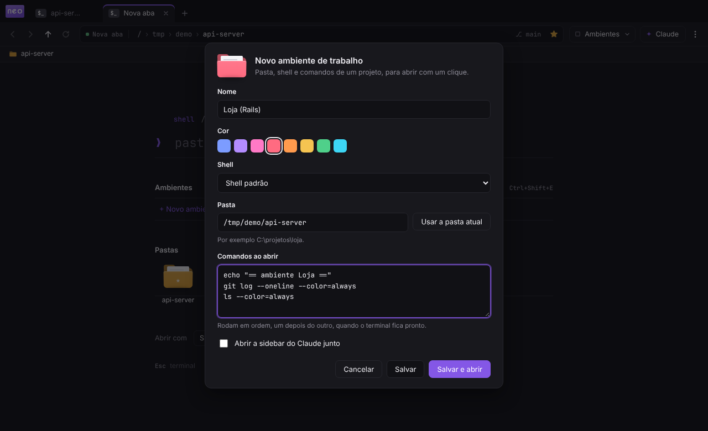
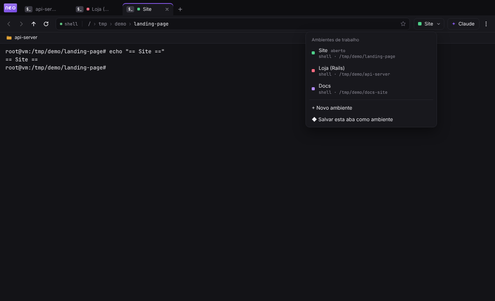
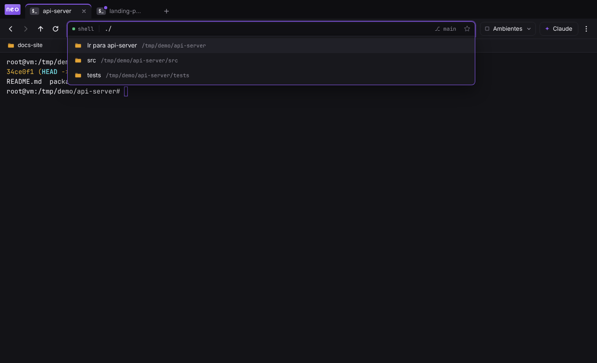

<p align="center">
  
</p>

<p align="center">
  <b>Um terminal para Windows que navega como o seu navegador.</b><br/>
  Abas, barra de endereço, voltar e avançar, favoritos, ambientes de trabalho, WSL e o Claude Code embutido.
</p>

<p align="center">
  
  
  
</p>

---

## A ideia

Você já sabe usar um navegador. O Neo CMD leva esse jeito de navegar para o terminal: cada aba é um terminal, a barra de endereço mostra onde você está, e voltar, avançar e favoritar funcionam como no Chrome. O cmd e o PowerShell continuam lá, de verdade; o Neo CMD só muda a forma de chegar até eles.

## Página de nova aba

<p align="center"></p>

Toda aba nova começa num prompt: a pasta atual em cima e uma linha de comando grande, que aceita pasta, comando, `@ambiente` ou `?pergunta`. Abaixo, seus **ambientes de trabalho** em lista e uma **prateleira de pastas** (favoritas primeiro, depois as mais visitadas). Clique e o terminal já abre ali, sem nenhum `cd` digitado.

## Ambientes de trabalho

<p align="center">
  
  
</p>

Mexe em vários projetos ao mesmo tempo? Salve cada um como um **ambiente**: nome, cor, shell (cmd, PowerShell ou **WSL com a distro que você escolher**), pasta, comandos ao abrir (por exemplo `rbenv shell 3.3.0` e `bundle install`) e, se quiser, a sidebar do Claude já aberta. Depois é só selecionar:

- botão **Ambientes** na barra de ferramentas (`Ctrl+Shift+E`);
- a lista de ambientes na página de nova aba;
- `@nome` na barra de endereço.

A aba ganha a cor e o nome do ambiente, e os comandos rodam em ordem, um depois do outro. "Salvar esta aba como ambiente" já preenche shell e pasta a partir da aba atual.

## Barra de endereço

<p align="center"></p>

A pasta atual aparece como uma trilha clicável (`~ › projetos › api`): clique em qualquer parte para subir até ela. Clique na barra (ou `Ctrl+L`) e digite:

| Você digita | O que acontece |
|---|---|
| um caminho (`C:\projetos`, `..\site`, `~\Downloads`) | vai até a pasta, com autocompletar de subpastas (`Tab` completa) |
| um comando (`npm test`) | executa na aba atual (ou numa aba nova, se a atual estiver ocupada) |
| `?` + pergunta (`?por que esse build falha`) | abre a sidebar e manda a pergunta para o Claude Code |
| `@` + nome (`@loja`) | abre um ambiente de trabalho (ou cria um novo com esse nome) |
| `>` + ação (`>tema`) | ações do app: temas, shells, ambientes, fonte, favoritos |

## Navegue como no navegador

<p align="center"></p>

- **Voltar, avançar e subir** (`Alt+←`, `Alt+→`, `Alt+↑`): cada aba guarda o histórico das pastas por onde passou.
- **Favoritos** (`Ctrl+D` ou ★): as pastas favoritas ganham uma barra própria. Clique para ir, `Ctrl+clique` para abrir em nova aba, botão direito para remover.
- **Abas que avisam**: enquanto um comando roda, o ícone da aba vira um indicador de carregamento; quando um comando termina numa aba em segundo plano, aparece um ponto, como uma notificação.
- **Branch do Git** e **shell da aba** sempre visíveis na barra de endereço.
- **Prompts bonitos funcionam:** ícones de Nerd Font (Clink, oh-my-posh, Starship) aparecem mesmo sem fonte especial instalada, e a barra de endereço acompanha o `cd` também com prompts personalizados do Clink.
- Abas que se arrastam, fecham com o botão do meio, renomeiam com duplo clique e reabrem com `Ctrl+Shift+T`.

## Claude Code embutido

<p align="center"></p>

O Claude Code vem dentro do app. Abra a sidebar com **✦ Claude** (`Ctrl+Shift+B`): cada aba tem a sua própria conversa, aberta na pasta daquela aba. Ele também funciona como aba própria e como o comando `claude` em qualquer terminal. Na primeira vez, o Claude Code pede para confirmar a pasta e fazer login.

## Temas

<p align="center">
  
  
</p>

Grafite, Meia-noite, Drácula e Claro, no menu **⋮**. Tema, fonte, favoritos, ambientes e pastas visitadas ficam salvos.

## WSL

As distros do WSL instaladas aparecem sozinhas como shells (`WSL · Ubuntu`, por exemplo): no menu, na página de nova aba e nos ambientes. A barra de endereço acompanha o `cd` dentro do Linux, completa pastas da distro e mostra a branch do Git; pastas do WSL visitadas aparecem com um pinguim e reabrem no WSL.

> Todas as imagens são capturas reais do app, feitas no Linux. No Windows, os shells são cmd, PowerShell, pwsh e as distros do WSL.

## Atalhos

| Ação | Atalho |
|---|---|
| Nova aba / fechar / reabrir fechada | `Ctrl+T` / `Ctrl+W` / `Ctrl+Shift+T` |
| Alternar abas / ir para a aba N | `Ctrl+Tab` / `Ctrl+1…9` |
| Barra de endereço | `Ctrl+L`, `Alt+D` ou `F6` |
| Voltar / avançar / pasta acima | `Alt+←` / `Alt+→` / `Alt+↑` |
| Favoritar a pasta | `Ctrl+D` |
| Ambientes de trabalho | `Ctrl+Shift+E` |
| Sidebar do Claude | `Ctrl+Shift+B` |
| Fonte maior / menor / padrão | `Ctrl +` / `Ctrl -` / `Ctrl 0` |
| Copiar / colar | `Ctrl+C` com seleção, `Ctrl+Shift+C/V`, botão direito |

Detalhes em [docs/USO.md](docs/USO.md).

## Instalação

Baixe o `NeoCMD-Setup-<versão>.exe` em [**Releases**](../../releases) e execute. A instalação é só para o seu usuário (não pede administrador), cria atalhos no menu Iniciar e na área de trabalho e tem desinstalador.

> O instalador não é assinado digitalmente, então o Windows SmartScreen pode avisar "editor desconhecido". Clique em **Mais informações → Executar assim mesmo**.

### A partir do código

Requisitos: [Node.js](https://nodejs.org) 22 ou superior.

```bash
git clone https://github.com/TGuiDev/neo-cmd.git
cd neo-cmd
npm install
npm start
```

Para gerar o instalador: `npm run dist` (no Windows). Veja [docs/COMPILAR.md](docs/COMPILAR.md).

## Documentação

- [Guia de uso](docs/USO.md)
- [Arquitetura](docs/ARQUITETURA.md)
- [Compilar e publicar](docs/COMPILAR.md)
- [Solução de problemas](docs/PROBLEMAS.md)

## Status

Projeto em fase inicial, desenvolvido e testado em Linux; o instalador para Windows é gerado automaticamente, mas ainda precisa de mais testes em máquinas Windows. Encontrou algo errado? Abra uma issue com a mensagem de erro.

## Tecnologias

[Electron](https://www.electronjs.org) · [xterm.js](https://xtermjs.org) · [@lydell/node-pty](https://github.com/lydell/node-pty) · [Claude Code](https://claude.com/claude-code)

## Licença

[MIT](LICENSE)
