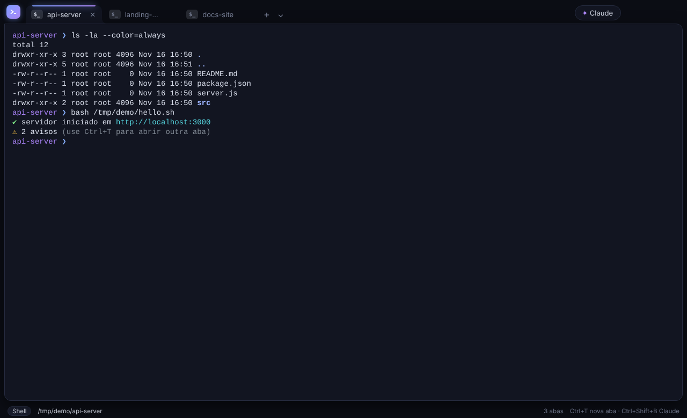
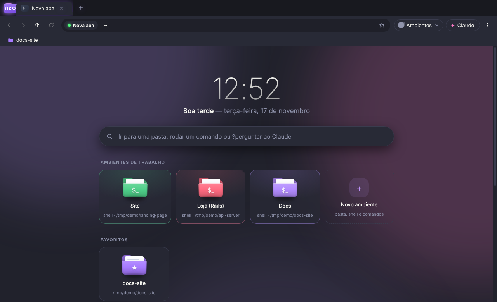
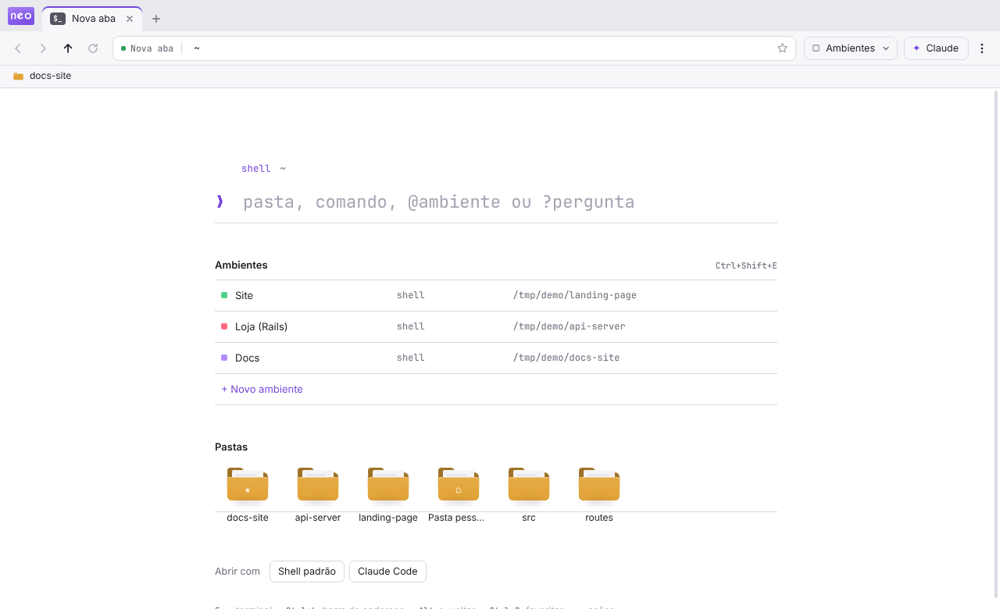
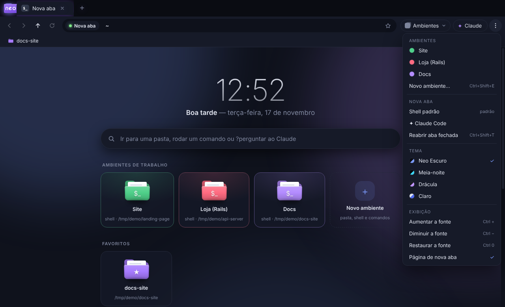

<p align="center">
  
</p>

<p align="center">
  <b>Um terminal para Windows com abas estilo navegador e o Claude Code embutido.</b><br/>
  Chega de uma janela por vez: abra, arraste, feche e reabra abas como no Chrome.
</p>

<p align="center">
  
  
  
</p>

---

## Por que existe

O Windows 10 não tem abas no `cmd`. O Neo CMD resolve isso e vai além: o **Claude Code** já vem dentro dele, tanto como comando em qualquer aba quanto numa **sidebar** ao lado do seu terminal.

## Veja funcionando

### Abas como no navegador

<p align="center"></p>

Cada aba mostra o nome da pasta em que está. Arraste para reordenar, feche com o botão do meio do mouse e reabra a última aba fechada com `Ctrl+Shift+T`.

### Claude Code na sidebar

<p align="center"></p>

Abra com o botão **✦ Claude** ou `Ctrl+Shift+B`. Cada aba tem a sua própria sessão do Claude, iniciada **na pasta atual daquela aba**. A largura se ajusta arrastando a divisória.

O Claude Code abre direto na sidebar, sem mostrar um shell chamando o comando. Na primeira execução ele pede para escolher um tema e fazer login, como em qualquer instalação nova.

### Temas e barra de status

<p align="center">
  
  
</p>

Quatro temas (Neo Escuro, Meia-noite, Drácula e Claro), trocados pelo menu **⌄**. A barra de status mostra o shell, a pasta atual e a branch do Git.

<p align="center"></p>

> Todas as imagens são capturas reais do app, feitas no Linux. No Windows, o menu lista cmd, PowerShell e pwsh no lugar de "Shell padrão".

## Recursos

| Recurso | Como usar |
|---|---|
| Nova aba | `Ctrl+T` ou botão **+** |
| Fechar aba | `Ctrl+W`, botão **✕** ou clique com o botão do meio |
| Reabrir aba fechada | `Ctrl+Shift+T` |
| Alternar abas | `Ctrl+Tab` / `Ctrl+Shift+Tab` |
| Ir para a aba N | `Ctrl+1` … `Ctrl+8` (`Ctrl+9` vai para a última) |
| Reordenar | Arrastar a aba |
| Renomear | Duplo clique na aba |
| Sidebar do Claude | `Ctrl+Shift+B` ou botão **✦ Claude** |
| Aba dedicada do Claude | Menu **▾** → *Nova aba do Claude* |
| Escolher shell | Menu **▾** (cmd, PowerShell, pwsh); botão direito num item o define como padrão |
| Tema | Menu **⌄** → Tema (fica salvo) |
| Tamanho da fonte | `Ctrl +` / `Ctrl -` / `Ctrl 0` |
| Copiar / colar | `Ctrl+C` (com seleção) · `Ctrl+Shift+C/V` · botão direito |

Detalhes completos em [docs/USO.md](docs/USO.md).

## Instalação

### Opção 1 — Instalador (recomendado)

Baixe o `NeoCMD-Setup-<versão>.exe` na página de [**Releases**](../../releases) e execute. A instalação é só para o seu usuário (não pede administrador), cria atalhos no menu Iniciar e na área de trabalho e tem desinstalador.

> O executável não é assinado digitalmente, então o Windows SmartScreen pode avisar "editor desconhecido". Clique em **Mais informações → Executar assim mesmo**.

### Opção 2 — Rodar a partir do código

Requisitos: [Node.js](https://nodejs.org) 22 ou superior.

```bash
git clone https://github.com/TGuiDev/neo-cmd.git
cd neo-cmd
npm install
npm start
```

### Gerar o seu próprio executável

```bash
npm run dist   # instalador em dist/ (gere no Windows)
```

Mais detalhes em [docs/COMPILAR.md](docs/COMPILAR.md).

## Documentação

- [Guia de uso](docs/USO.md): atalhos, abas, shells e a sidebar do Claude.
- [Arquitetura](docs/ARQUITETURA.md): como o app é organizado por dentro.
- [Compilar e publicar](docs/COMPILAR.md): gerar o `.exe` e publicar um Release.
- [Solução de problemas](docs/PROBLEMAS.md): erros comuns e como resolver.

## Status

Projeto em fase inicial. O app foi desenvolvido e testado em Linux; o executável para Windows foi gerado, mas ainda precisa de mais testes em máquinas Windows. Se encontrar algo errado, abra uma issue com a mensagem de erro.

## Tecnologias

[Electron](https://www.electronjs.org) · [xterm.js](https://xtermjs.org) · [@lydell/node-pty](https://github.com/lydell/node-pty) · [Claude Code](https://claude.com/claude-code)

## Licença

[MIT](LICENSE)
